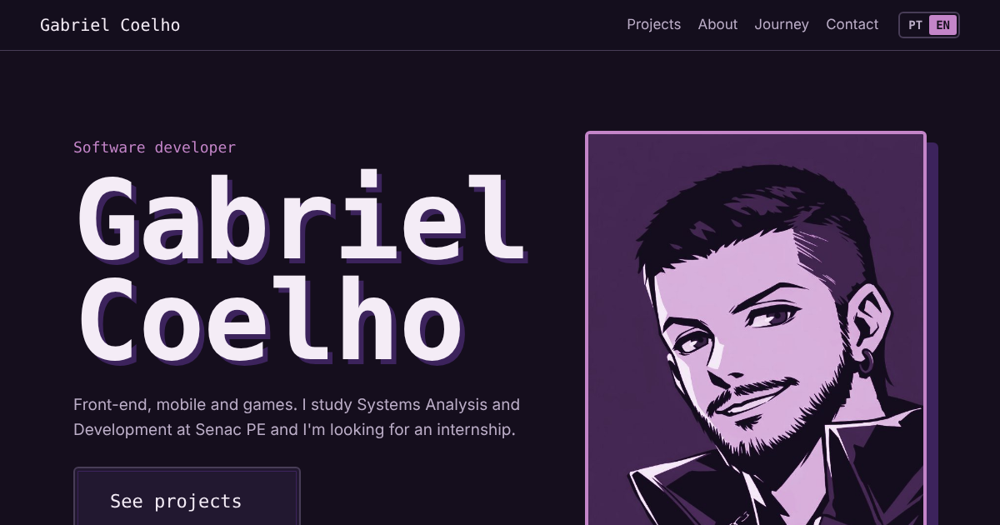

# Portfólio · Gabriel Coelho

Meu portfólio em **React + Vite**, com visual de menu de jogo, versão em **português e inglês** e deploy automático no **GitHub Pages**.

🎮 **Acesse:** https://biieru.github.io/



## ✨ O que tem

- **Tela de título** com menu navegável pelas setas do teclado (↑ ↓ e Enter), como em um jogo
- **Projetos** em cartões com filtro por área (front-end e mobile, back-end e dados, testes, games)
- **Ficha de personagem** na seção Sobre: formação, idiomas, disponibilidade e tecnologias
- **Jornada** em linha do tempo e artigos do dev.to
- **Botão PT/EN**: a escolha fica salva no navegador; na primeira visita o idioma segue o do navegador
- Currículo em PDF nos dois idiomas
- Layout responsivo, foco visível no teclado, link para pular ao conteúdo e respeito a `prefers-reduced-motion`
- Prévia com imagem quando o link é compartilhado no LinkedIn e no WhatsApp

## 🛠️ Tecnologias

React 19 · Vite · CSS puro · GitHub Actions · GitHub Pages

## 📁 Estrutura

```
src/
├── content.js   # TODOS os textos (PT e EN), links e projetos — edite aqui
├── App.jsx      # componentes da página
├── styles.css   # cores e fontes ficam no topo, em :root
└── main.jsx     # ponto de entrada
public/
├── img/                          # retratos
├── curriculo-gabriel-coelho.pdf  # currículo PT
├── resume-gabriel-coelho.pdf     # currículo EN
└── og-image.png                  # imagem de prévia para redes sociais
.github/workflows/deploy.yml      # build e publicação a cada push na main
```

## ➕ Como adicionar um projeto

Em `src/content.js`, copie um bloco dentro de `projects`, troque nome, categoria (`front`, `back`, `qa` ou `games`), stack e links, e escreva os textos em `pt` e `en`.

## ▶️ Rodando localmente

```bash
npm install
npm run dev
```
